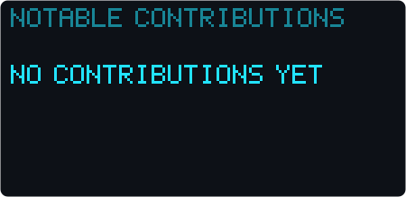

  

  
  
  

---

## Sobre Mim

Sou desenvolvedor backend e estudante de Engenharia de Software, com foco em APIs REST, produtos SaaS, automação de processos e integrações com IA. Trabalho com Python, FastAPI, PostgreSQL e Redis para construir aplicações com autenticação, processamento assíncrono, validação de dados, persistência relacional e integrações externas.

Tenho experiência prática em projetos como micro SaaS de análise ATS de currículos, auditoria fiscal com IA e dashboards comerciais em tempo real. Também atuo com suporte e diagnóstico de software/hardware, aplicando troubleshooting técnico, padronização de processos e melhoria de fluxo operacional.

- Backend com Python, FastAPI, Pydantic, SQLAlchemy e PostgreSQL.
- Produtos SaaS com autenticação Magic Link, quotas, paywall PIX, webhooks e controle de sessão.
- Integrações com OpenRouter, Claude, Gemini, Resend e Mercado Pago.
- Processamento de documentos, validação JSON, exportação CSV/Excel e dashboards com Chart.js.
- Base sólida em troubleshooting, Docker, Git/GitHub e deploy em Render e Vercel.

---

## Stack Tecnológica

### Linguagens

  
  
  
  
  

### Backend e APIs

  
  
  
  
  
  

### Frontend e Visualização

  
  
  
  

### Dados e Processamento

  
  
  
  

### Cloud, DevOps e Ferramentas

  
  
  
  
  

### IA e Integrações

  
  
  
  
  

---

## Projetos em Destaque

### Parserly - Micro SaaS de análise ATS de currículos

Micro SaaS para análise de compatibilidade ATS com upload de PDF/DOCX, extração de texto, IA via OpenRouter, relatórios com score de 0 a 100, recomendações priorizadas e persistência em PostgreSQL.

- Processou 131 análises de currículos.
- Implementa autenticação Magic Link, cookies HTTPOnly, controle de sessão, quota gratuita e paywall PIX.
- Usa FastAPI async, Pydantic v2, Redis, Resend, Mercado Pago, Docker e tratamento de timeouts/retries.

  

### DocAudit - Sistema de análise de documentos fiscais

API REST de auditoria fiscal para registro de uploads, detecção de anomalias e exportação de dados financeiros para CSV/Excel.

- Integra FastAPI, PostgreSQL, SQLAlchemy, OpenRouter, pandas e openpyxl.
- Centraliza análise de documentos e geração de saídas estruturadas para auditoria.

  

### Sales Dash PRO - Dashboard de vendas em tempo real

Dashboard full-stack para análise de faturamento, ticket médio e KPIs comerciais com API REST, PostgreSQL, HTML/CSS/JavaScript e visualizações com Chart.js.

- Entrega leitura rápida de indicadores comerciais.
- Deploy realizado na Render.

  

---

## GitHub

  

  
  

  
  

---

## Contato

  
  
  
  

  

<!-- cool-readme:start -->
<!-- Cards by github-cool-readme: https://github.com/pedrocatalao/github-cool-readme -->

<picture>
  <source media="(prefers-color-scheme: dark)" srcset="https://raw.githubusercontent.com/kaikerod/kaikerod/cards/summary-dark.svg">
  
</picture>
<picture>
  <source media="(prefers-color-scheme: dark)" srcset="https://raw.githubusercontent.com/kaikerod/kaikerod/cards/languages-dark.svg">
  
</picture>

<picture>
  <source media="(prefers-color-scheme: dark)" srcset="https://raw.githubusercontent.com/kaikerod/kaikerod/cards/contributions-dark.svg">
  
</picture>
<picture>
  <source media="(prefers-color-scheme: dark)" srcset="https://raw.githubusercontent.com/kaikerod/kaikerod/cards/weekly-dark.svg">
  
</picture>

<!-- cool-readme:end -->
