<div align="center">

  <!-- Header Banner Pixel Art -->
  <a href="https://github.com/kaikerod">
    
  </a>

  <!-- Animated retro divider -->
  

  <p align="center">
    <b>👾 Desenvolvedor Backend & Estudante de Engenharia de Software 🇧🇷</b><br>
    <i>Especialista em APIs REST assíncronas, produtos Micro SaaS, integrações de IA e arquiteturas escaláveis.</i>
  </p>

  <p align="center">
    <a href="https://www.linkedin.com/in/kaike-rodrigues/" target="_blank">
      
    </a>
    <a href="https://kaike-portfolio.netlify.app/" target="_blank">
      
    </a>
    <a href="mailto:contato.kaikevinicius@gmail.com">
      
    </a>
  </p>

</div>

---

### 🎮 Player Character Sheet

```text
╭────────────────────────────────────────────────────────────────────────╮
│  👾 PLAYER STATS                                                       │
│  Name        : Kaike Rodrigues                                         │
│  Class       : Backend Architect & Systems Sorcerer 🧙‍♂️                 │
│  Specialty   : Async APIs, Micro SaaS, AI Pipelines & Automation       │
│  HP          : [████████████████████] 100% (Coffee Powered ☕)         │
│  MP          : [██████████████████░░]  94% (Clean Code Mana ✨)        │
│  Location    : Brazil 🇧🇷                                               │
│  Status      : Online & Leveling Up ⚡                                 │
│  Main Quest  : Building high-performance SaaS & intelligent systems    │
╰────────────────────────────────────────────────────────────────────────╯
```

---

### 🕹️ Pixel Art Stats Display

<!-- cool-readme:start -->
<!-- Cards by github-cool-readme: https://github.com/pedrocatalao/github-cool-readme -->
<p align="center">
<picture>
  <source media="(prefers-color-scheme: dark)" srcset="https://raw.githubusercontent.com/kaikerod/kaikerod/cards/summary-dark.svg">
  
</picture>
<picture>
  <source media="(prefers-color-scheme: dark)" srcset="https://raw.githubusercontent.com/kaikerod/kaikerod/cards/languages-dark.svg">
  
</picture>
</p>
<p align="center">
<picture>
  <source media="(prefers-color-scheme: dark)" srcset="https://raw.githubusercontent.com/kaikerod/kaikerod/cards/contributions-dark.svg">
  
</picture>
<picture>
  <source media="(prefers-color-scheme: dark)" srcset="https://raw.githubusercontent.com/kaikerod/kaikerod/cards/weekly-dark.svg">
  
</picture>
</p>
<!-- cool-readme:end -->

---

### 📖 Sobre Mim

Sou desenvolvedor backend e estudante de Engenharia de Software, com foco em **APIs REST**, **produtos SaaS**, **automação de processos** e **integrações com IA**. Trabalho com **Python**, **FastAPI**, **PostgreSQL** e **Redis** para construir aplicações com autenticação robusta, processamento assíncrono, validação de dados, persistência relacional e integrações externas.

Tenho experiência prática em projetos como micro SaaS de análise ATS de currículos, auditoria fiscal com IA e dashboards comerciais em tempo real. Também atuo com suporte e diagnóstico de software/hardware, aplicando troubleshooting técnico, padronização de processos e melhoria de fluxo operacional.

* ⚙️ **Backend:** Python, FastAPI, Pydantic v2, SQLAlchemy e PostgreSQL.
* 💳 **Produtos SaaS:** Autenticação Magic Link, cookies HTTPOnly, quotas, paywall PIX (Mercado Pago), webhooks e controle de sessão.
* 🤖 **IA & Pipelines:** Integrações diretas com OpenRouter, Claude, Gemini e Resend.
* 📊 **Processamento de Dados:** Validação JSON, extração PDF/DOCX, exportação CSV/Excel e dashboards dinâmicos.
* 🚀 **DevOps & Infra:** Docker, Git/GitHub, troubleshooting avançado e deploy na Render e Vercel.

---

### ⚔️ Tech Arsenal & Skill Tree

<div align="center">

  #### 💻 Linguagens
  
  
  
  
  
  

  <br>

  #### 🛡️ Backend, APIs & Arquitetura
  
  
  
  
  
  

  <br>

  #### 🤖 IA & Integrações SaaS
  
  
  
  
  

  <br>

  #### 🗄️ Dados & Processamento
  
  
  
  

  <br>

  #### ☁️ DevOps, Cloud & Infra
  
  
  
  
  
  

</div>

---

### 🗺️ Featured Quests & Repositories

| Quest / Projeto | Stack | Destaques |
|:---|:---:|:---|
| 🚀 **[Parserly](https://github.com/kaikerod/Parserly)** | `FastAPI` • `Redis` • `PostgreSQL` • `OpenRouter` | Micro SaaS para análise ATS de currículos. Magic link auth, paywall PIX, relatórios com IA e +130 análises processadas. |
| 📑 **[Doc-Audit](https://github.com/kaikerod/Doc-Audit)** | `FastAPI` • `SQLAlchemy` • `pandas` • `openpyxl` | API REST para auditoria fiscal, detecção de anomalias com IA e exportação de relatórios estruturados. |
| 📊 **[Sales Dash PRO](https://github.com/kaikerod/sales-dash)** | `FastAPI` • `PostgreSQL` • `Chart.js` • `Render` | Dashboard comercial em tempo real para análise de faturamento, ticket médio e KPIs comerciais. |
| 🛠️ **[Repar.io](https://github.com/kaikerod/Repar.io)** | `Python` • `APIs REST` | Sistema de controle e padronização operacional para ordens de serviço e manutenções. |
| 🔄 **[PartSync](https://github.com/kaikerod/PartSync)** | `Web App` • `Automation` | Aplicação web para cotações, solicitações de compras e sincronização ágil de peças. |

---

### 📡 Telemetria & Conexões

<div align="center">
  <a href="https://www.linkedin.com/in/kaike-rodrigues/" target="_blank">
    
  </a>
  &nbsp;
  <a href="https://kaike-portfolio.netlify.app/" target="_blank">
    
  </a>
  &nbsp;
  <a href="mailto:contato.kaikevinicius@gmail.com">
    
  </a>
  &nbsp;
  <a href="https://github.com/kaikerod" target="_blank">
    
  </a>
</div>

<br>

<div align="center">
  
</div>
